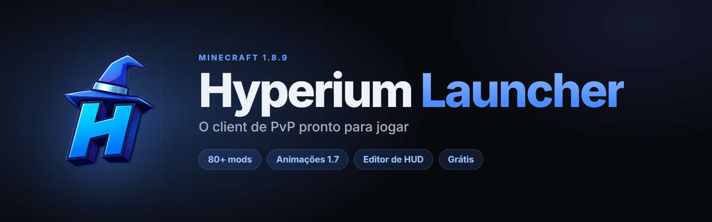
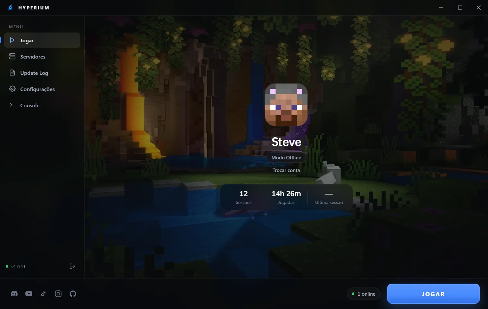
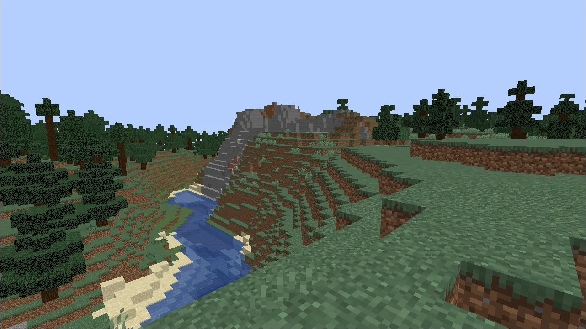
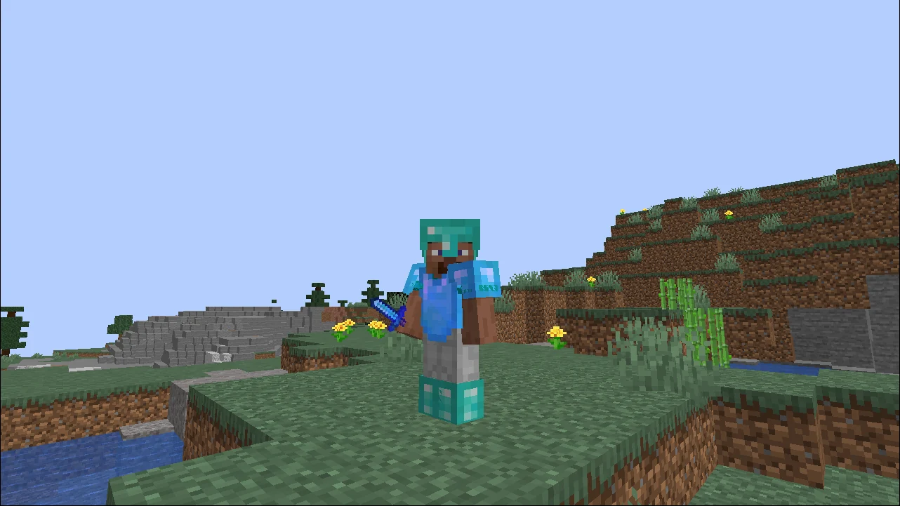
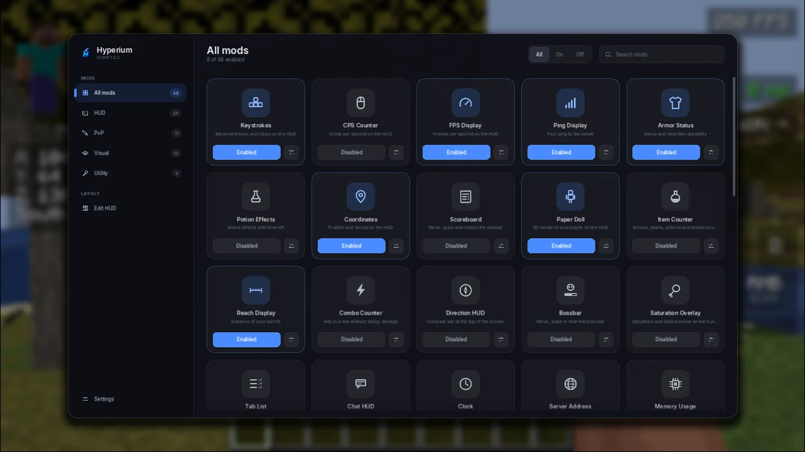
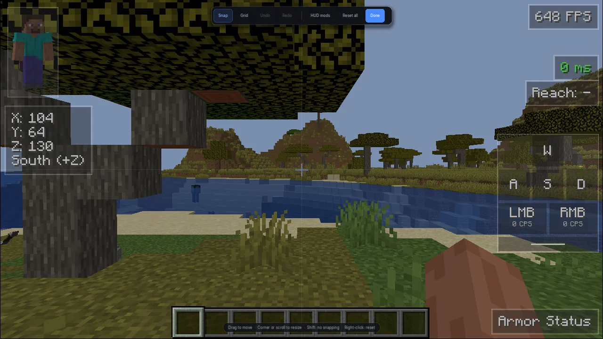

  

  
  &nbsp;
  
  &nbsp;
  
  &nbsp;
  

  <b>Mais de 80 mods de PvP, HUD e desempenho, já configurados de fábrica.</b> 
  Instale, entre na sua conta e jogue. Grátis para Windows, macOS e Linux.

 

  

## Download

| | Sistema | Arquivo |
|:-:|---|---|
|  | **Windows** 10 e 11 | [`Hyperium-Setup.exe`](https://github.com/arthwr14/hyperium-launcher/releases/latest) |
|  | **macOS** (Apple Silicon, M1 em diante) | [`Hyperium-Launcher-arm64.dmg`](https://github.com/arthwr14/hyperium-launcher/releases/latest) |
|  | **macOS** (Intel) | [`Hyperium-Launcher-x64.dmg`](https://github.com/arthwr14/hyperium-launcher/releases/latest) |
|  | **Linux** Ubuntu / Debian | [`Hyperium-Launcher-amd64.deb`](https://github.com/arthwr14/hyperium-launcher/releases/latest) |
|  | **Linux** (outras distros) | [`Hyperium-Launcher-x86_64.AppImage`](https://github.com/arthwr14/hyperium-launcher/releases/latest) |

> [!TIP]
> O jeito mais fácil é pelo site: **[arthwr14.github.io/hyperium-launcher](https://arthwr14.github.io/hyperium-launcher/)**. Ele já mostra o download certo para o seu sistema.

## Recursos

<table>
  <tr>
    <td width="33%" valign="top">
      <h3>⚔️ Feito para PvP</h3>
      Animações da 1.7, Hit Color, Hitboxes, Reach Display, Combo Counter, Toggle Sprint e correção do atraso do mouse.
    </td>
    <td width="33%" valign="top">
      <h3>🧩 HUD do seu jeito</h3>
      Keystrokes, CPS, FPS, Armor Status, Minimap e muito mais, posicionados no editor de HUD com ímã e guias.
    </td>
    <td width="33%" valign="top">
      <h3>⚡ Mais FPS</h3>
      OptiFine integrado e um mod de desempenho que corta o que você não vê e acelera a troca de mundos.
    </td>
  </tr>
  <tr>
    <td valign="top">
      <h3>🎨 Visual moderno</h3>
      Texturas novas do Minecraft no 1.8.9, camadas de skin em 3D, Item Physics e painel de mods em cartões.
    </td>
    <td valign="top">
      <h3>👥 Jogue com amigos</h3>
      Ícone do Hyperium ao lado do nome de quem usa o client, mensagens entre jogadores e Discord Presence.
    </td>
    <td valign="top">
      <h3>🔄 Sem complicação</h3>
      Baixa o Java e o Minecraft sozinho. No Windows, as versões novas chegam automaticamente.
    </td>
  </tr>
</table>

## O visual do 26.3, o PvP do 1.8.9

Texturas, armaduras, itens e menus das versões novas do Minecraft. O combate, o knockback e as hitboxes continuam os do 1.8.9.

  
  

## Painel de mods

Aperte <kbd>Right Shift</kbd> dentro do jogo para ligar, desligar e ajustar qualquer mod.

  

## Editor de HUD

Arraste, redimensione e alinhe cada elemento da tela. <kbd>Ctrl</kbd>+<kbd>Z</kbd> desfaz.

  

## Dúvidas

<b>O Windows mostrou “O Windows protegeu o computador”</b>

 
O aviso aparece com programas novos que ainda não têm assinatura digital paga. Clique em <b>Mais informações</b> → <b>Executar assim mesmo</b>.

<b>No Mac aparece que o app não pode ser aberto</b>

 
Na primeira vez, clique com o <b>botão direito</b> no Hyperium Launcher → <b>Abrir</b> e confirme.

<b>Preciso instalar o Java ou o Forge?</b>

 
Não. O launcher baixa o Java e o Minecraft 1.8.9 sozinho na primeira vez que você clica em Jogar.

<b>Como abro o painel de mods?</b>

 
Dentro do jogo, aperte <kbd>Right Shift</kbd>. A tecla pode ser trocada nas configurações do painel.

 

  <a href="https://dsc.gg/hypernotwork">Discord</a> ·
  <a href="https://www.youtube.com/@4rth3n">YouTube</a> ·
  <a href="https://www.tiktok.com/@arth3n">TikTok</a> ·
  <a href="https://www.instagram.com/4rth3n">Instagram</a>

© arthwr14. Todos os direitos reservados. Este repositório contém apenas os instaladores e o site. Hyperium não é afiliado à Mojang Studios nem à Microsoft.

